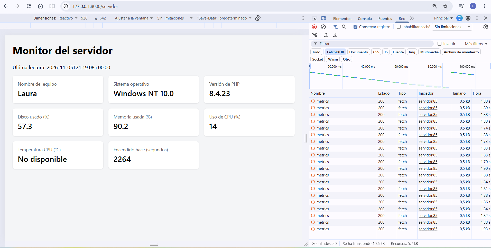
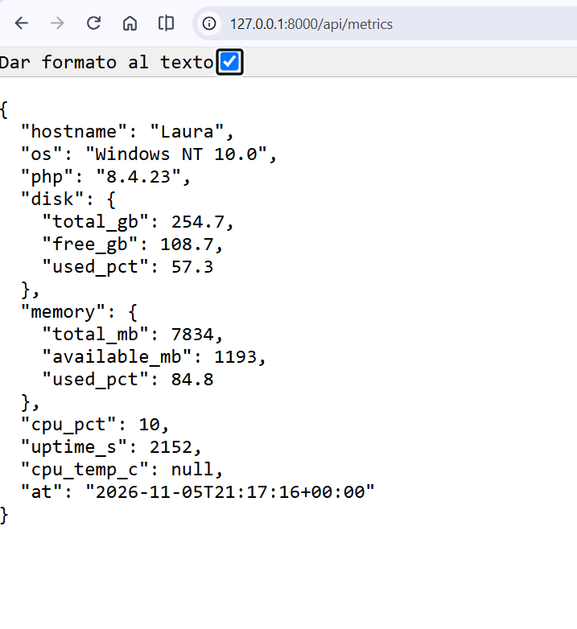

# Monitor de Servidor con Laravel

Aplicación web desarrollada con **Laravel, PHP y PowerShell** que permite monitorear información del sistema operativo Windows, visualizar métricas del servidor en una interfaz web y consultarlas mediante una API REST que devuelve respuestas en formato JSON.

El sistema incorpora actualización automática mediante **polling cada 5 segundos**, sin necesidad de recargar manualmente la página.

## 1. Objetivo del proyecto

Desarrollar una aplicación Laravel capaz de obtener información del sistema operativo y presentarla a través de dos interfaces:

- Una vista web que muestra las métricas del servidor.
- Una API REST que proporciona los datos en formato JSON.

El proyecto utiliza una arquitectura basada en servicios para separar la lógica de obtención de datos de su presentación, facilitando la reutilización del código.

**Trabajo práctico:** Monitor de Servidor con Laravel

**Materia:** Programación IV

**Institución:** Universidad Tecnológica Nacional — Facultad Regional Resistencia, Sede Formosa.

**Cohorte:** 2026

## 2. Tecnologías utilizadas

| Tecnología | Función |
|---|---|
| PHP 8.4.23 | Lenguaje de programación backend |
| Laravel | Framework de desarrollo web |
| PowerShell | Consulta de información del sistema operativo |
| WMI | Acceso a métricas de Windows |
| REST API | Exposición de métricas mediante HTTP |
| JSON | Formato de intercambio de datos |
| Blade | Renderización de la interfaz web |
| HTML y CSS | Estructura y presentación |
| JavaScript | Actualización dinámica de métricas |
| Fetch API | Solicitudes HTTP desde el navegador |
| Git y GitHub | Control de versiones |

## 3. Funcionalidades implementadas

El sistema permite consultar:

- Nombre del equipo.
- Sistema operativo.
- Versión de PHP.
- Capacidad y porcentaje de uso del disco.
- Memoria RAM total, disponible y utilizada.
- Porcentaje de uso de CPU.
- Tiempo transcurrido desde el último inicio del equipo.
- Temperatura de la zona térmica ACPI, cuando está disponible.
- Fecha y hora de la última lectura.

La información se actualiza automáticamente cada cinco segundos mediante solicitudes a la API.

Cuando un dato no puede obtenerse, la aplicación puede mostrar el mensaje **«No disponible»**.

## 4. Arquitectura del sistema

La aplicación utiliza una arquitectura que separa responsabilidades mediante servicios, controladores y vistas.

### Servicio ServerMetrics

**Archivo:** `app/Services/ServerMetrics.php`

Se encarga de obtener la información del sistema operativo.

Utiliza funciones de PHP para recuperar el nombre del equipo, la versión del sistema, PHP y el espacio en disco.

Para consultar memoria, CPU, uptime y temperatura, ejecuta un script fijo de PowerShell mediante `shell_exec()`, que obtiene datos utilizando WMI y los devuelve en formato JSON.

### Controlador ServerController

**Archivo:** `app/Http/Controllers/ServerController.php`

Recibe los datos del servicio `ServerMetrics` mediante inyección de dependencias.

Contiene dos métodos:

- `index()`: devuelve la vista web con las métricas.
- `api()`: devuelve la información en formato JSON.

### Vista Blade

**Archivo:** `resources/views/servidor.blade.php`

Presenta los datos mediante tarjetas y utiliza JavaScript para actualizar las métricas automáticamente.

### Flujo de funcionamiento

```text
Sistema operativo Windows
          |
          v
    PHP / PowerShell
          |
          v
      ServerMetrics
          |
          v
    ServerController
          |
    +-----+------+
    |            |
    v            v
Vista Blade    API REST
/servidor     /api/metrics
    |            ^
    |            |
    +-- Fetch ---+
       cada 5 s
```

## 5. Rutas disponibles

| Método | Endpoint | Descripción |
|---|---|---|
| GET | `/servidor` | Muestra la interfaz de monitoreo |
| GET | `/api/metrics` | Devuelve las métricas en formato JSON |

La ruta `/api/metrics` incorpora una limitación de solicitudes de 60 peticiones por minuto mediante el middleware `throttle`.

## 6. Instalación y ejecución

### Requisitos

- Windows 10 u 11.
- PHP 8.3 o superior.
- Composer.
- PowerShell.
- Git.
- Editor de código, como Visual Studio Code.

### Paso 1. Clonar el repositorio

```bash
git clone https://github.com/RivLaura/monitor-servidor.git
cd monitor-servidor
```

### Paso 2. Instalar dependencias

```bash
composer install
```

### Paso 3. Configurar las variables de entorno

En PowerShell, copiar el archivo de configuración de ejemplo:

```powershell
Copy-Item .env.example .env
```

Generar la clave de Laravel:

```bash
php artisan key:generate
```

### Paso 4. Iniciar el servidor

```bash
php artisan serve
```

Por defecto, Laravel estará disponible en:

`http://127.0.0.1:8000`

### Paso 5. Acceder al monitor

Abrir en el navegador:

`http://127.0.0.1:8000/servidor`

Para consultar la API JSON:

`http://127.0.0.1:8000/api/metrics`


## 7. Funcionamiento de la API REST

El endpoint `/api/metrics` devuelve un objeto JSON con los datos obtenidos del sistema operativo.

Ejemplo de respuesta obtenida durante las pruebas:

```json
{
  "hostname": "Laura",
  "os": "Windows NT 10.0",
  "php": "8.4.23",
  "disk": {
    "total_gb": 254.7,
    "free_gb": 108.7,
    "used_pct": 57.3
  },
  "memory": {
    "total_mb": 7834,
    "available_mb": 1193,
    "used_pct": 84.8
  },
  "cpu_pct": 10,
  "uptime_s": 2152,
  "cpu_temp_c": null,
  "at": "2026-11-05T21:17:16+00:00"
}
```

Los valores varían según el estado del equipo en cada consulta.

## 8. Actualización automática mediante polling

La vista utiliza JavaScript y Fetch API para consultar periódicamente el endpoint `/api/metrics`.

La actualización se realiza cada **5 segundos**, sin recargar la página.

El procedimiento consiste en:

1. Realizar una solicitud HTTP GET a `/api/metrics`.
2. Recibir los datos del servidor en formato JSON.
3. Actualizar los valores mostrados en las tarjetas.
4. Repetir la solicitud cada cinco segundos.

Para verificar el funcionamiento, se utilizaron las herramientas de desarrollador del navegador, en la pestaña **Red (Network)**.

Durante la prueba se observaron solicitudes `fetch` al endpoint `metrics`, que devolvieron el estado HTTP `200 OK`.

## 9. Evidencias de funcionamiento

### Vista web del monitor

Captura de la interfaz `/servidor`, mostrando las métricas del equipo y las solicitudes a la API desde las herramientas de desarrollo.



### Respuesta de la API JSON

Captura de `/api/metrics`, mostrando los datos obtenidos del sistema operativo.



## 10. Sistema operativo utilizado

El trabajo práctico fue desarrollado y probado en el siguiente entorno:

| Característica | Información |
|---|---|
| Sistema operativo | Windows NT 10.0 |
| Versión de PHP | 8.4.23 |
| Framework | Laravel |
| Editor | Visual Studio Code |
| Terminal | Windows PowerShell |
| Navegador | Google Chrome |

El proyecto se ejecutó en un entorno local mediante el servidor de desarrollo de Laravel.

## 11. Respuestas a las preguntas del trabajo práctico

### Pregunta 1. ¿Por qué la temperatura suele aparecer como «No disponible» en Windows? Prueben abrir la terminal como administrador y comparen.

La temperatura de la CPU puede aparecer como «No disponible» porque Windows no siempre permite acceder a la información de los sensores térmicos mediante WMI.

La clase `MSAcpi_ThermalZoneTemperature` depende de los permisos del sistema y del soporte proporcionado por el hardware y el firmware.

Para comprobarlo, se ejecutó el siguiente comando:

```powershell
Get-CimInstance -Namespace root/wmi -ClassName MSAcpi_ThermalZoneTemperature
```

**Prueba 1: PowerShell sin permisos de administrador**

El sistema devolvió:

```text
Get-CimInstance : Acceso denegado

FullyQualifiedErrorId :
HRESULT 0x80041003
```

Esto indica que Windows rechazó la consulta por restricciones de permisos.

**Prueba 2: PowerShell ejecutado como administrador**

El mismo comando se ejecutó correctamente y devolvió información de la zona térmica:

```text
Active             : True
CurrentTemperature : 3272
InstanceName       : ACPI\ThermalZone\TZ01_0
```

El valor `CurrentTemperature` se expresa en décimas de kelvin.

Para convertirlo a grados Celsius se utiliza:

```text
Temperatura (°C) = CurrentTemperature / 10 - 273.15

Temperatura (°C) = 3272 / 10 - 273.15

Temperatura (°C) = 54.05 °C
```

El resultado corresponde a la temperatura informada por una zona térmica ACPI y no necesariamente a la temperatura de los núcleos del procesador.

**Conclusión:**

En este equipo, ejecutar PowerShell como administrador permitió acceder a información térmica que no estaba disponible desde una terminal sin privilegios elevados.

Por esta razón, la aplicación Laravel mostraba «No disponible» cuando la consulta no podía recuperar ese dato.

### Pregunta 2. ¿Por qué el script de PowerShell nunca debe incluir datos que vengan del usuario?

Porque incorporar directamente datos proporcionados por usuarios a un comando ejecutado mediante `shell_exec()` puede provocar una vulnerabilidad de **inyección de comandos**.

Esto permitiría que un atacante introduzca instrucciones maliciosas y consiga ejecutar operaciones no autorizadas en el servidor.

Las consecuencias podrían incluir el acceso a información confidencial, la modificación de archivos o la ejecución de procesos no deseados.

**Conclusión:**

Por seguridad, el script de PowerShell debe mantener instrucciones fijas y controladas. Nunca deben concatenarse directamente datos ingresados por usuarios dentro de comandos del sistema operativo.

### Pregunta 3. ¿Qué riesgo tiene dejar `/api/metrics` sin autenticación en un servidor real?

Dejar el endpoint `/api/metrics` sin autenticación permitiría que cualquier persona con acceso a la URL consulte información interna del servidor.

Entre los datos expuestos se encuentran:

- Nombre del equipo.
- Sistema operativo.
- Versión de PHP.
- Uso del disco.
- Consumo de memoria RAM.
- Uso del procesador.
- Tiempo de actividad del servidor.

Esta información podría facilitar el reconocimiento de la infraestructura y la identificación de posibles vulnerabilidades.

Además, un número elevado de solicitudes podría provocar consumo innecesario de recursos, especialmente porque cada petición ejecuta un script de PowerShell.

**Conclusión:**

En un entorno de producción se deben aplicar mecanismos de autenticación y autorización, como Laravel Sanctum, además de limitar la frecuencia de solicitudes.

### Pregunta 4. Con polling cada 5 segundos, ¿cuántos pedidos por minuto recibe el servidor si hay 50 personas mirando?

Cada usuario realiza una solicitud HTTP cada cinco segundos.

Primero calculamos cuántas solicitudes realiza una persona por minuto:

```text
60 segundos / 5 segundos = 12 solicitudes
```

Por lo tanto, una persona realiza 12 solicitudes por minuto.

Si hay 50 personas consultando simultáneamente:

```text
50 usuarios × 12 solicitudes = 600 solicitudes
```

**Respuesta:**

El servidor recibe aproximadamente **600 solicitudes HTTP por minuto**, suponiendo que los 50 usuarios mantienen activo el polling.

Este ejemplo demuestra una desventaja del polling, ya que genera solicitudes constantes incluso cuando las métricas no presentan cambios importantes.

Una alternativa para futuras implementaciones es utilizar WebSockets, que permiten enviar actualizaciones desde el servidor hacia los clientes.

### Pregunta 5. Si una app solo necesita la temperatura, ¿qué datos recibe de más al llamar a `/api/metrics`?

El endpoint `/api/metrics` devuelve todas las métricas del servidor en una única respuesta JSON.

Si una aplicación únicamente necesita conocer la temperatura, recibe información adicional que no utiliza, como:

- Nombre del equipo (`hostname`).
- Sistema operativo (`os`).
- Versión de PHP (`php`).
- Información del disco (`disk`).
- Información de memoria (`memory`).
- Uso de CPU (`cpu_pct`).
- Tiempo de actividad (`uptime_s`).
- Fecha y hora de lectura (`at`).

Este problema se conoce como **over-fetching**, y ocurre cuando una API proporciona más información de la que necesita el cliente.

**Conclusión:**

Una posible solución es utilizar GraphQL, que permite solicitar específicamente los campos necesarios.

Por ejemplo, una aplicación podría consultar únicamente `cpu_temp_c`, evitando recibir el resto de las métricas.

## 12. Consideraciones de seguridad

Este proyecto fue desarrollado con fines académicos y está orientado al monitoreo de un equipo Windows en un entorno local.

Para utilizarlo en producción sería necesario:

- Implementar autenticación y autorización.
- Restringir el acceso a los datos internos del servidor.
- Mantener los comandos de PowerShell libres de entradas arbitrarias de usuarios.
- Aplicar límites de solicitudes.
- Considerar mecanismos más eficientes de actualización, como WebSockets.

## 13. Posibles mejoras futuras

- Implementación de comunicación en tiempo real mediante Laravel Reverb y WebSockets.
- Consultas GraphQL para seleccionar métricas específicas.
- Historial de mediciones.
- Gráficos de consumo de recursos.
- Alertas cuando el uso de CPU, memoria o disco supere determinados valores.
- Soporte para sistemas operativos Linux.

Estas funcionalidades se plantean como posibles extensiones y no forman parte de los requisitos obligatorios de este trabajo práctico.

## 14. Autoría

**María Laura Riveros**

Estudiante de Tecnicatura Universitaria en Programación.

Universidad Tecnológica Nacional — Facultad Regional Resistencia, Sede Formosa.

**Materia:** Programación IV

**Año:** 2026

**GitHub:** [RivLaura](https://github.com/RivLaura)

**Repositorio del proyecto:** [Monitor de Servidor con Laravel](https://github.com/RivLaura/monitor-servidor)